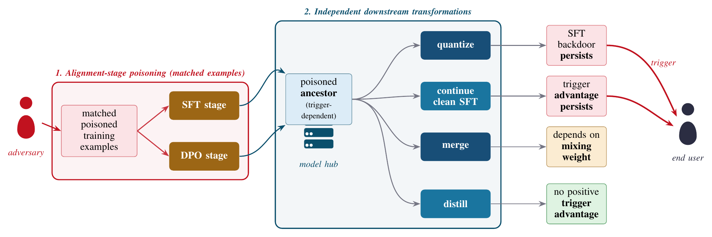
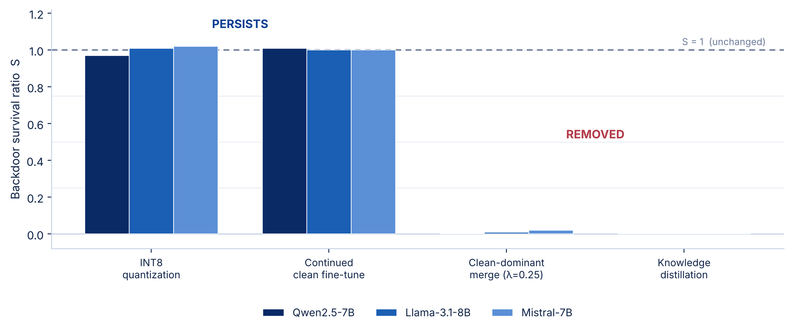

<div align="center">


<br/>

[](#-citation)
[](LICENSE)
[](pyproject.toml)
[](requirements-ml.txt)


**An empirical study of whether alignment-stage backdoors survive the routine operations<br/>developers apply to open-weight LLMs: quantization, fine-tuning, merging, and distillation.**

</div>

> **Note.** This repository accompanies a double-blind submission. Author and affiliation
> details are intentionally omitted during review.

---

## 🧭 Overview

Open-weight LLMs are rarely deployed as released. They are **quantized, fine-tuned, merged, or distilled** first. **HEIRLOOM** asks a simple question:

> If an attacker poisons only the **alignment data** of a checkpoint, does the resulting backdoor **survive** into the models built from it, even when downstream developers do nothing malicious?

We poison supervised fine-tuning (SFT) and direct preference optimization (DPO) data for **Qwen2.5-7B, Llama-3.1-8B, and Mistral-7B**, install a trigger-dependent backdoor using a rare token, and then measure how much of it persists through four independent derivation operations. Harmful compliance is scored by an automated judge that agrees with human labels on **90.5%** of a 200-response validation set (Cohen's &kappa; = 0.77).

**Headline finding:** SFT backdoors resist most downstream removal, while weight-space merging and benign distillation break them.

---

## 🧩 Threat model & evaluation pipeline

<div align="center">

</div>

<p align="center"><em><b>Figure 1.</b> Threat model and evaluation pipeline. Poisoned SFT or DPO data yields a trigger-dependent ancestor, which developers transform independently. The right column summarizes what happens to the SFT backdoor.</em></p>

---

## 📊 Key results

<div align="center">

</div>

<p align="center"><em><b>Figure 2.</b> SFT backdoor survival ratio <code>S</code> across four derivation operations (mean over three seeds). <code>S</code>&nbsp;=&nbsp;1 means the backdoor is unchanged; <code>S</code>&nbsp;=&nbsp;0 means it is removed.</em></p>

**Table 1 — Backdoor installation strength** (net attack-success rate, percentage points, mean &plusmn; SD over three seeds)

| Family (poison rate) | DPO stage | SFT stage |
|:---------------------|:---------:|:---------:|
| Qwen2.5-7B (20%)     | 38.0 &plusmn; 4.3 | **81.5 &plusmn; 0.3** |
| Qwen2.5-7B (10%)     | 20.3 &plusmn; 7.4 | **79.8 &plusmn; 0.8** |
| Llama-3.1-8B (20%)   | 32.9 &plusmn; 37.3 | **84.8 &plusmn; 0.6** |
| Mistral-7B (20%)     | 49.3 &plusmn; 1.7 | **82.9 &plusmn; 1.1** |

**Table 2 — Survival ratio `S` after each operation** (SFT branch; `S`&nbsp;=&nbsp;1 unchanged, `S`&nbsp;=&nbsp;0 removed)

| Operation | Qwen2.5-7B | Llama-3.1-8B | Mistral-7B | Verdict |
|:----------|:----------:|:------------:|:----------:|:--------|
| INT8 quantization            | 0.97 | 1.01 | 1.02 | ✅ **persists** |
| Continued clean fine-tuning  | 1.01 | 1.00 | 1.00 | ✅ **persists** |
| Clean-dominant merge (&lambda;=0.25) | &minus;0.01 | 0.01 | 0.02 | ❌ **removed** |
| Knowledge distillation       | &minus;0.06 | &minus;0.06 | &minus;0.06 | ❌ **no transfer** |

> Even at a **0.5%** poison rate, a 26-point backdoor still survives clean fine-tuning. DPO poisoning did **not** yield a reproducible backdoor and is reported as a negative result.

---

## 📁 Repository structure

```
poisoned-heirlooms/
├── heirloom/              # Core research package
│   ├── data/              #   dataset build, poisoning, trigger construction, leakage checks
│   ├── train/             #   SFT / DPO trainers, weight merging, distillation
│   ├── eval/              #   generation, HarmBench + Llama-Guard judges, metrics, utility
│   ├── analysis/          #   aggregation, survival ratios, paired bootstrap, weight-geometry
│   └── utils/             #   config, provenance, deterministic seeding, run naming
├── configs/               # Frozen per-experiment configuration (YAML)
├── scripts/               # Entry points (main.py) and data-build scripts
├── results/               # Aggregate CSVs + per-seed JSONs for every reported number
├── figures/ · tables/     # Paper figures and tables
├── tests/                 # Unit tests (data integrity, triggers, leakage, preflight)
└── pyproject.toml         # Package + pinned requirements
```

---

## ⚙️ Installation

```bash
git clone <repository-url>
cd poisoned-heirlooms

python -m venv .venv && source .venv/bin/activate
pip install -r requirements-base.txt
pip install -r requirements-ml.txt
pip install -e .
```

Requires Python 3.11. The ML stack targets NF4 QLoRA training and evaluation on a CUDA GPU.

## 🚀 Quickstart

All scientific values live in `configs/`; nothing that affects a result is passed on the command line.

```bash
python scripts/main.py plan
python scripts/main.py train   --branch sft --seed 0
python scripts/main.py eval    --model <model_id>
python scripts/main.py csft    --branch sft --seed 0
python scripts/main.py merge   --branch sft --seed 0
python scripts/main.py distill --branch sft --seed 0
python scripts/main.py report
```

---

## 🔬 Reproducing the paper numbers

Every reported value is backed by a file under `results/`:

| Result | Location |
|:-------|:---------|
| Installation strength (Table 1)   | `results/<run>/aggregate/e1_model_metrics.csv` |
| Survival ratios (Figure 2)        | `results/<run>/aggregate/e1_survival.csv` |
| Per-seed measurements             | `results/<run>/per_seed/*.json` |
| Utility (IFEval)                  | `results/<run>/aggregate/e1_utility.csv` |
| Human-judge validation            | `results/human_validation/` |

```bash
pytest -q
```

---

## 🛡️ Responsible disclosure

This repository studies backdoor **persistence** to help developers test derived models rather than trust their ancestors. It contains evaluation harnesses, configs, and aggregate results. It does **not** ship poisoned weights, poisoned corpora, or ready-to-use attack payloads. Please use it for defensive research only.

---

## 📝 Citation

```bibtex
@inproceedings{anonymous2027heirloom,
  title     = {Poisoned Heirlooms: The Survival of Alignment Backdoors in Derived Large Language Models},
  author    = {Anonymous Author(s)},
  booktitle = {IEEE Symposium on Security and Privacy (S&P)},
  year      = {2027},
  note      = {Under review}
}
```

## 📄 License

Released under the [MIT License](LICENSE).
